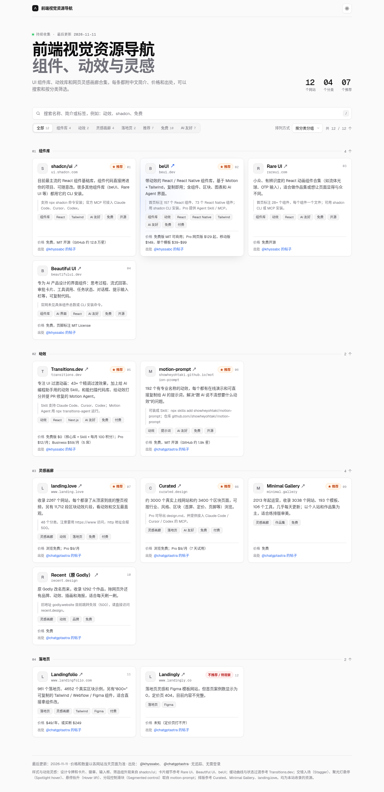

# 前端视觉资源导航

前端视觉、UI 组件、动效与落地页灵感网站的精选合集。每个站点都附中文简介、价格说明与出处，支持搜索、筛选、收藏和一键复制。

**线上地址**：<https://frontend-visual-resources.vercel.app> · **旧版页面**：<https://frontend-visual-resources.vercel.app/v1/>

[](https://frontend-visual-resources.vercel.app)

<sub>移动端深色模式预览见 [`preview-mobile-dark.png`](./preview-mobile-dark.png)。</sub>

## 功能特性

- **20 个精选站点**，分为组件库（4）、动效（4）、灵感画廊（7）、落地页（5）4 个分类。
- **即时搜索**：支持空格分隔的多个关键词，命中内容自动高亮。
- **筛选与排序**：按分类、推荐、免费、AI 友好、收藏筛选；支持分类分组、推荐优先、按名称排序。
- **双视图**：网格卡片与紧凑列表一键切换，偏好本地记忆。
- **本地收藏**：点击卡片书签即可收藏，数据只存在浏览器 `localStorage`。
- **一键复制**：复制站点网址或 CLI 安装命令，并给出轻提示。
- **深浅色主题**：默认跟随系统，手动切换后记忆选择；带圆形扩散转场并避免首屏闪烁。
- **键盘操作**：`/` 搜索、`R` 随机灵感、`V` 切换视图、`Shift+B` 设计稿透视。
- **隐藏彩蛋**：连点左上角图标 5 次，或在搜索框输入 `彩蛋`、`egg`、`surprise`、`blueprint`、`线稿` 任一关键词。
- **静态、轻量、无追踪**：构建时预渲染，无需登录，不含分析脚本。

## 快速开始

要求 **Node.js ≥ 20.9**（Next.js 16 的最低版本要求）。

```bash
git clone https://github.com/VitaminC1989/frontend-visual-resources.git
cd frontend-visual-resources
npm install
npm run dev        # http://localhost:3000
```

### 常用脚本

| 命令 | 说明 |
| --- | --- |
| `npm run dev` | 启动开发服务器（热更新） |
| `npm run build` | 生产构建，页面静态预渲染 |
| `npm start` | 运行生产构建产物 |
| `npm run lint` | ESLint 检查 |
| `npm run typecheck` | 生成 Next 类型并执行 TypeScript 检查 |

提交前建议至少跑一遍 `npm run typecheck` 和 `npm run lint`。

## 交互与快捷键

| 操作 | 说明 |
| --- | --- |
| `/` 或 `⌘/Ctrl + K` | 聚焦搜索框 |
| `Esc` | 清空并退出搜索，或关闭提示 / 取消随机结果 |
| `R` | 随机抽取一个站点；随后按 `Enter` 直接打开 |
| `V` | 切换网格 / 列表视图 |
| `Shift + B` | 切换「设计稿透视模式」 |
| 连点左上角图标 5 次 | 同上，解锁隐藏透视视图 |
| 搜索 `彩蛋` / `egg` / `surprise` / `blueprint` / `线稿` | 触发隐藏入口页 |

## 目录结构

```text
src/
  app/
    layout.tsx          # 根布局：元信息、Geist 字体、主题初始化脚本
    page.tsx            # 首页入口
    globals.css         # 设计令牌、浅色/深色主题与全部样式
    icon.svg            # favicon
  components/
    ResourcePage.tsx    # 页面主体：搜索、筛选、排序、快捷键、彩蛋、Toast
    ResourceCard.tsx    # 资源卡片 / 列表行、复制与收藏
    FilterChips.tsx     # 分段筛选与弹簧滑块指示器
    ThemeToggle.tsx     # 深浅色切换与圆形扩散转场
    BrandMark.tsx       # 顶栏标识，连点 5 次触发彩蛋
    Highlight.tsx       # 搜索关键词高亮
    RollingNumber.tsx   # 滚动数字
    ScrollProgress.tsx  # 顶部阅读进度条
    StatusToast.tsx     # 全局轻提示
    MotionProvider.tsx  # 统一尊重 prefers-reduced-motion
  data/
    resources.ts        # ★ 站点数据、分类、出处与最后更新日期
  lib/
    filter.ts           # 筛选 / 搜索 / 排序逻辑
    storage.ts          # localStorage：收藏与视图偏好
    theme.ts            # 主题存储键与防闪烁脚本
public/
  v1/index.html         # 旧版静态页面，访问 /v1/
```

## 维护数据

所有内容都集中在 [`src/data/resources.ts`](src/data/resources.ts)，新增或修改条目无需改动组件。

### 新增一个站点

1. 在 `RESOURCES` 数组中添加一项，字段如下：

   | 字段 | 必填 | 说明 |
   | --- | --- | --- |
   | `name` | 是 | 站点名称 |
   | `url` | 是 | 网址，同时作为收藏标识 |
   | `category` | 是 | 必须是 `CATEGORIES` 之一 |
   | `desc` | 是 | 中文简介 |
   | `tags` | 是 | 标签；`免费`、`AI 友好` 会出现在筛选栏 |
   | `price` | 是 | 价格说明 |
   | `note` | 否 | 补充说明，如组件数量、安装方式 |
   | `command` | 否 | CLI 安装命令，卡片中可一键复制（目前仅 shadcn/ui、Transitions.dev、motion-prompt 三条提供） |
   | `rec` | 否 | `true` 显示「推荐」徽章 |
   | `warn` | 否 | 警示文案，优先级高于推荐 |
   | `source` | 是 | 必须是 `SOURCES` 的键（出处） |

2. 如引用新的出处，先在 `SOURCES` 中登记 `label` 与 `url`。
3. 同步更新 `LAST_UPDATED`（页面标题区与页脚共用这一处）。
4. 运行 `npm run typecheck`，确认分类与出处均通过类型校验。

## 技术栈

| 层 | 选型 |
| --- | --- |
| 框架 | [Next.js 16](https://nextjs.org)（App Router） |
| UI | React 19 + 手写 CSS 设计令牌（无 UI 框架） |
| 类型 | TypeScript 6（`strict`） |
| 动效 | [Motion](https://motion.dev)（`motion/react`） |
| 字体 | Geist Sans / Geist Mono（`geist`） |
| 部署 | Vercel（`vercel.json` 指定 Next.js） |

## 部署

- 页面在 `next build` 时静态预渲染，可直接部署到 Vercel 或任意支持 Next.js 的平台。
- 不需要任何环境变量或后端服务。
- 旧版页面以静态文件形式保留在 `public/v1/index.html`，由 [`next.config.ts`](next.config.ts) 将 `/v1` 重写到该文件。

## 说明

- 站点价格、组件数量和可用性以各网站当天页面为准；数据更新日期见页面顶部。
- 收藏、视图与主题偏好仅保存在当前浏览器的 `localStorage`（键名：`fvr-saved`、`fvr-view`、`fvr-theme`）。
- 页面中的样式与动效参考了本站收录的 shadcn/ui、beUI、Transitions.dev 等资源，具体致谢见页脚。
